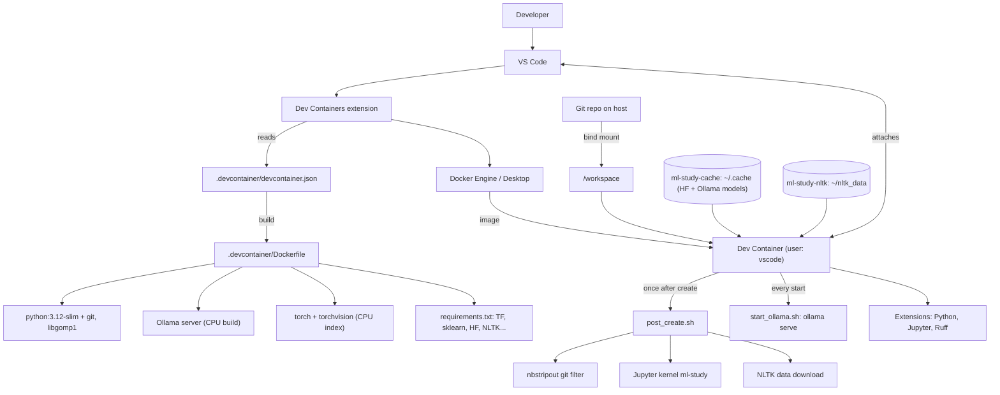

# Dev Container for ML study (CPU-only)

One container with Python 3.12, Jupyter, scikit-learn, LightGBM, XGBoost,
TensorFlow/Keras, PyTorch, Hugging Face, NLTK, OpenCV, LangChain and Ollama
(local LLMs such as Mistral). No GPU needed. Works on Linux (x86_64),
macOS Apple Silicon and Windows (Docker Desktop + WSL2).

## How it works



## Setup
1. Install Docker Desktop (Windows/macOS) or Docker Engine (Linux), and
   start it.
2. Install VS Code and the **Dev Containers** extension.
3. Clone this repo:
   `git clone https://github.com/digitalPatch/dev_container_for_ML_by_sabra`
4. Open the folder in VS Code.
5. Click **Reopen in Container** (or press F1 →
   "Dev Containers: Reopen in Container").
6. Wait for the first build (10–20 min, ~6 GB). Later rebuilds reuse the
   cache.
7. Open a notebook and pick the kernel **Python 3.12 (ml-study)**.

## Windows
1. Enable WSL2 in Docker Desktop (Settings → General →
   "Use the WSL 2 based engine").
2. Clone inside WSL for much faster file access: open Ubuntu (WSL), run the
   `git clone` from step 3, then run `code .` in that folder.
3. If you clone from Windows instead, use **Git Bash** and run
   `git config --global core.autocrlf input` before cloning.
   `.gitattributes` already forces LF, so `post_create.sh` still runs.

## Notebooks
1. Commit notebooks as usual (`git add`, `git commit`).
2. Rely on nbstripout: it is set up automatically in the container and strips
   outputs on commit. Your local file keeps its outputs.
3. Commit only from the container terminal (the filter lives there).

## Local LLMs with Ollama
The Ollama server starts by itself with the container
(`.devcontainer/start_ollama.sh`, log in `/tmp/ollama.log`). Models live
in the `ml-study-cache` volume, so they survive rebuilds.

1. Download Mistral once (~4 GB) in the container terminal:
   `ollama pull mistral`
2. Test it: `ollama run mistral "shalom"`
3. Use it from LangChain:

   ```python
   from langchain_ollama import ChatOllama

   llm = ChatOllama(model="mistral")
   print(llm.invoke("Say shalom in one sentence.").content)
   ```

4. If the server is not running, start it again:
   `bash .devcontainer/start_ollama.sh`

Mistral 7B needs about 5 GB of free RAM. On macOS and Windows, raise the
Docker Desktop memory limit to 8 GB or more (Settings → Resources).

## Data and models
1. Put datasets in `data/`; they are git-ignored.
2. Force-add a small sample if needed: `git add -f data/sample.csv`.

## Update packages
1. Edit `requirements.txt`.
2. Run F1 → "Dev Containers: Rebuild Container".
